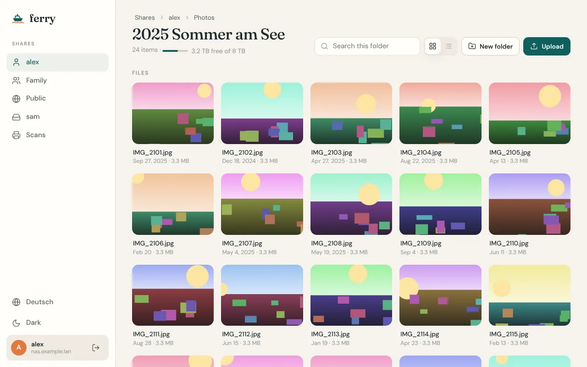
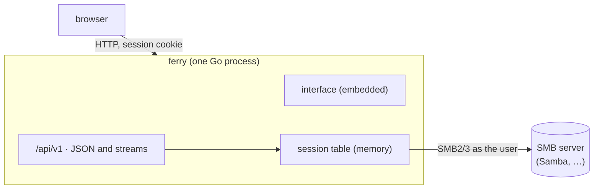
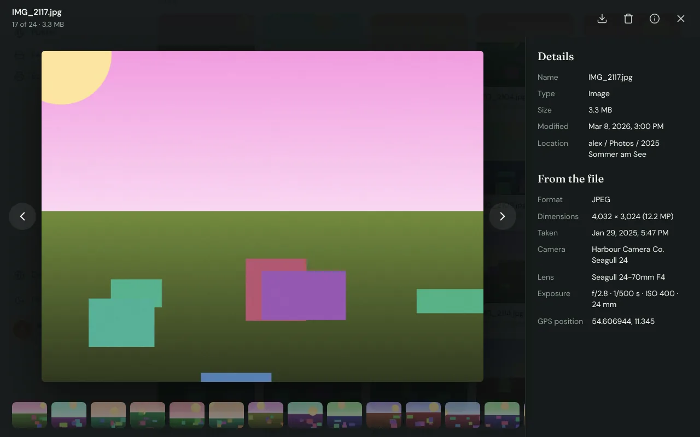
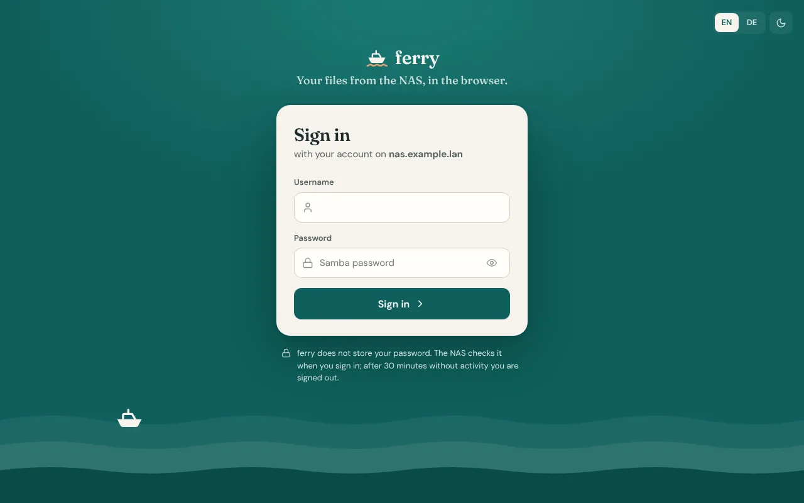
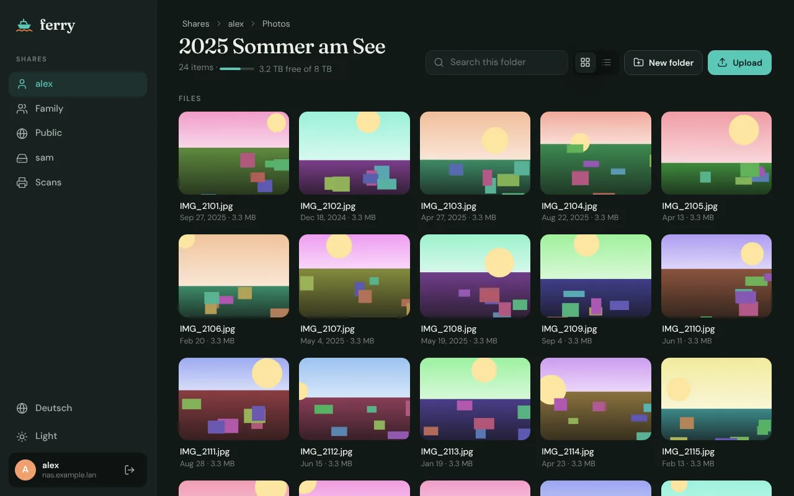
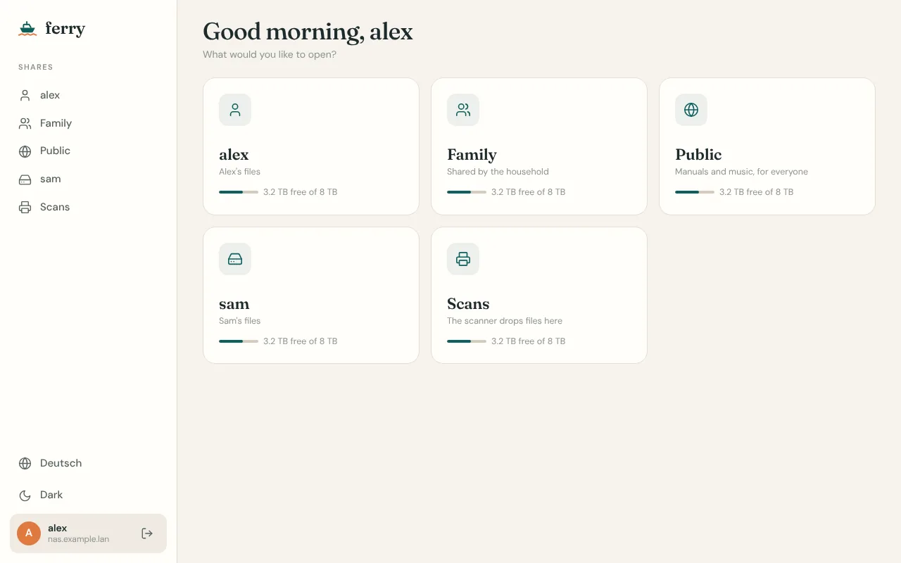
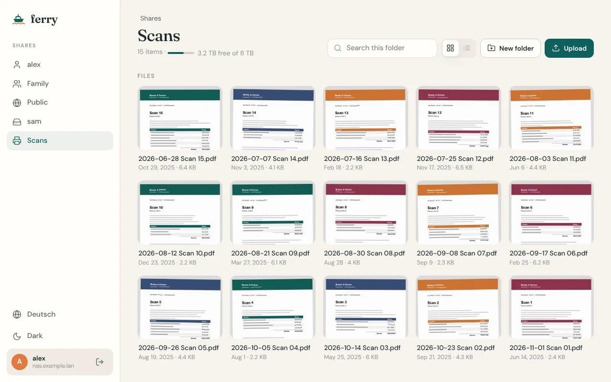

<p align="center">
  <picture>
    <source media="(prefers-color-scheme: dark)" srcset=".metapatrol/ferry-lockup-dark.png">
    
  </picture>
</p>

<p align="center">
  <strong>SMB shares in the browser: log in with your Samba account, and see exactly what Samba lets you see. No users, no database, nothing stored.</strong>
</p>

<p align="center">
  <a href="https://github.com/metapatrol/ferry/releases"></a>
  <a href="LICENSE"></a>
  
</p>

<p align="center">
  <a href="CONCEPT.md">Concept</a> ·
  <a href="docs/installation.md">Installation</a> ·
  <a href="docs/interface.md">Interface</a> ·
  <a href="charts/ferry/README.md">Helm chart</a> ·
  <a href="docs/configuration.md">Configuration</a> ·
  <a href="docs/operations.md">Operations</a> ·
  <a href="docs/samba.md">Samba</a> ·
  <a href="api/openapi/ferry-v1.yaml">API</a> ·
  <a href="docs/mockup/index.html">Mockup</a> ·
  <a href="CONTRIBUTING.md">Contributing</a> ·
  <a href="SECURITY.md">Security</a>
</p>

<p align="center">
  
</p>

---

> **Status:** young; 0.1.0 is the first public release. The 0.x releases
> work against Samba and are used at home; the API, the settings and the
> chart's values may still change before 1.0, and the
> [changelog](CHANGELOG.md) says when they do.

## Why

A NAS shares its disks through Samba, and Explorer, Finder and the phones'
file apps speak SMB directly. A browser cannot. The web file managers that
fill the gap either keep users of their own, store SMB credentials, read the
disks behind Samba's back — or are heavy and unpleasant to use.

ferry is one more SMB client that happens to draw a web page. You log in with
your Samba username and password; ferry opens an SMB session as you and
ferries files between the share and the browser. Samba checks the password
and decides every access, exactly as it does for Explorer. ferry adds no
rights and removes none, and keeps nothing: no users, no database, no tokens,
no volumes — but an optional, encrypted cache of thumbnails, served only to
whoever may read the file.

## How it works



- **The login is the SMB session setup.** `POST /api/v1/login` dials the
  configured server and authenticates with exactly the credentials typed. If
  Samba says no — or would only offer a guest session — the answer is 401.
  Otherwise ferry keeps the live SMB session under a random session cookie
  and forgets the password.
- **Its own SMB connections per browser session.** A login sets up a few
  (three by default), all while the password is there: one for browsing,
  the others for thumbnails and downloads, so a folder opens while pictures
  load. Identities never share a connection; logout and the idle timeout
  close them; a restart ends every session and loses nothing else.
- **Samba decides.** Shares come from the server's own share enumeration on
  your session; every listing, download, upload, rename and delete is an SMB
  call as you. What Samba refuses is a precise problem response (403, 404,
  409, 502), never an empty listing.
- **User content stays inert.** Downloads are attachments; previews are
  sandboxed and served with non-active content types, so an uploaded HTML or
  SVG file cannot run script in ferry's origin.
- **Small.** One static binary with the interface embedded, on a distroless
  image, non-root, read-only root filesystem, no volumes unless the cache
  is on.

## Scope

In scope: logging in with Samba credentials; the shares a user may see;
browsing, streamed downloads with Range, streamed uploads, folders, rename,
move and delete; previews and thumbnails for images, PDF, video, audio and
text; a calm interface that works on a phone, in English and German, light
and dark.

Not in scope: user, group, password or share administration (Samba's job);
sharing links, guest access and public URLs; sync clients, WebDAV and apps;
indexed search; editing documents in the browser; backends other than
SMB2/3; TLS termination (the gateway in front does it).

## Screenshots

| | |
|---|---|
|  |  |
| The details of a file, read from the file itself | Sign in with the NAS account |
|  |  |
| Dark | The shares, with their free space |
|  | |
| PDFs show their first page | |

On a phone: <a href="docs/images/phone-folder-en.webp">a folder</a> and
<a href="docs/images/phone-lightbox-en.webp">a photo</a>; in German:
<a href="docs/images/folder-de.webp">a folder</a> and
<a href="docs/images/lightbox-de.webp">the details</a>. All of it is the mock
NAS's fictional data; `make dev-nas screenshots` makes the pictures again
(hack/screenshots).

## Installation

```sh
helm install ferry oci://ghcr.io/metapatrol/charts/ferry --version 0.1.0 \
  --set smb.server=nas.example.lan
```

`smb.server` is the one value ferry needs. Put TLS in front of it — the
Ingress or your gateway — or passwords cross the network readable.
[docs/installation.md](docs/installation.md) has TLS, the trusted proxies,
memory and running without Kubernetes; the
[releases](https://github.com/metapatrol/ferry/releases) list the newest
version.

## Quick start

```sh
make dev-nas            # a mock household NAS with sample files on :4455 (podman; CONTAINER=docker)
make ui-build run-nas   # ferry with its interface on http://localhost:8095: alex / alex-nas-demo
```

```sh
make test-samba lint ui-test ui-lint   # the tests (against `make dev-samba`) and the linters
```

The API is [api/openapi/ferry-v1.yaml](api/openapi/ferry-v1.yaml), the
settings are in [docs/configuration.md](docs/configuration.md), the
interface is described in [docs/interface.md](docs/interface.md).

## Contributing

See [CONTRIBUTING.md](CONTRIBUTING.md). Security problems: [SECURITY.md](SECURITY.md).

## License

Apache-2.0, see [LICENSE](LICENSE). The metapatrol name and marks are not
covered by it: see [TRADEMARKS.md](TRADEMARKS.md).
