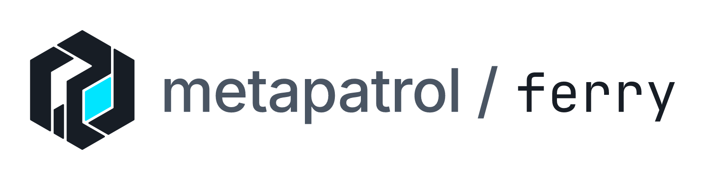
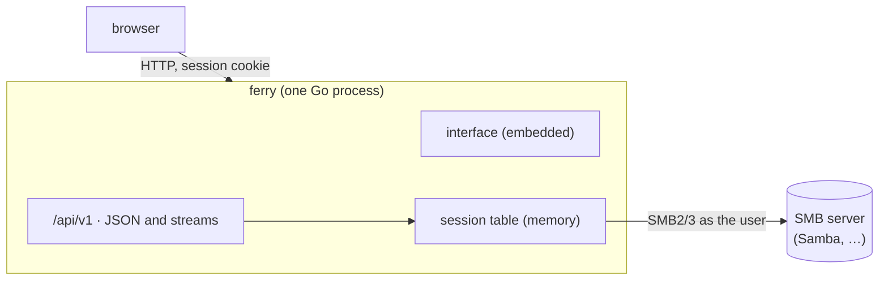

<p align="center">
  <picture>
    <source media="(prefers-color-scheme: dark)" srcset=".metapatrol/ferry-lockup-dark.png">
    
  </picture>
</p>

<p align="center">
  <strong>SMB shares in the browser: log in with your Samba account, and see exactly what Samba lets you see. No users, no database, nothing stored.</strong>
</p>

<p align="center">
  <a href="https://github.com/metapatrol/ferry/releases"></a>
  <a href="LICENSE"></a>
  
</p>

<p align="center">
  <a href="CONCEPT.md">Concept</a> ·
  <a href="docs/configuration.md">Configuration</a> ·
  <a href="docs/operations.md">Operations</a> ·
  <a href="docs/samba.md">Samba</a> ·
  <a href="api/openapi/ferry-v1.yaml">API</a> ·
  <a href="docs/mockup/index.html">Mockup</a> ·
  <a href="CONTRIBUTING.md">Contributing</a> ·
  <a href="SECURITY.md">Security</a>
</p>

---

> **Status:** early development. The design is settled ([CONCEPT.md](CONCEPT.md))
> and the interface's look is approved ([docs/mockup/](docs/mockup/index.html));
> the service is being built. There is no release yet.

## Why

A NAS shares its disks through Samba, and Explorer, Finder and the phones'
file apps speak SMB directly. A browser cannot. The web file managers that
fill the gap either keep users of their own, store SMB credentials, read the
disks behind Samba's back — or are heavy and unpleasant to use.

ferry is one more SMB client that happens to draw a web page. You log in with
your Samba username and password; ferry opens an SMB session as you and
ferries files between the share and the browser. Samba checks the password
and decides every access, exactly as it does for Explorer. ferry adds no
rights and removes none, and keeps nothing: no users, no database, no tokens,
no volumes.

## How it works



- **The login is the SMB session setup.** `POST /api/v1/login` dials the
  configured server and authenticates with exactly the credentials typed. If
  Samba says no — or would only offer a guest session — the answer is 401.
  Otherwise ferry keeps the live SMB session under a random session cookie
  and forgets the password.
- **One SMB connection per browser session.** Identities never share a
  connection; logout and the idle timeout close it; a restart ends every
  session and loses nothing else.
- **Samba decides.** Shares come from the server's own share enumeration on
  your session; every listing, download, upload, rename and delete is an SMB
  call as you. What Samba refuses is a precise problem response (403, 404,
  409, 502), never an empty listing.
- **User content stays inert.** Downloads are attachments; previews are
  sandboxed and served with non-active content types, so an uploaded HTML or
  SVG file cannot run script in ferry's origin.
- **Small.** One static binary with the interface embedded, on a distroless
  image, non-root, read-only root filesystem, no volumes.

## Scope

In scope: logging in with Samba credentials; the shares a user may see;
browsing, streamed downloads with Range, streamed uploads, folders, rename,
move and delete; previews and thumbnails for images, PDF, video, audio and
text; a calm interface that works on a phone, in English and German, light
and dark.

Not in scope: user, group, password or share administration (Samba's job);
sharing links, guest access and public URLs; sync clients, WebDAV and apps;
indexed search; editing documents in the browser; backends other than
SMB2/3; TLS termination (the gateway in front does it).

## Quick start

```sh
make dev-samba               # a test Samba on :4445 (podman; CONTAINER=docker)
make test-samba lint         # the tests against it, and the linters
make run                     # ferry on :8095 against it: log in as alex / alex-test-password
```

```sh
curl -s localhost:8095/api/v1/info
```

The interface is not built in yet; the API is at `/api/v1`
([api/openapi/ferry-v1.yaml](api/openapi/ferry-v1.yaml)), configured as in
[docs/configuration.md](docs/configuration.md).

## Contributing

See [CONTRIBUTING.md](CONTRIBUTING.md). Security problems: [SECURITY.md](SECURITY.md).

## License

Apache-2.0, see [LICENSE](LICENSE). The metapatrol name and marks are not
covered by it: see [TRADEMARKS.md](TRADEMARKS.md).
