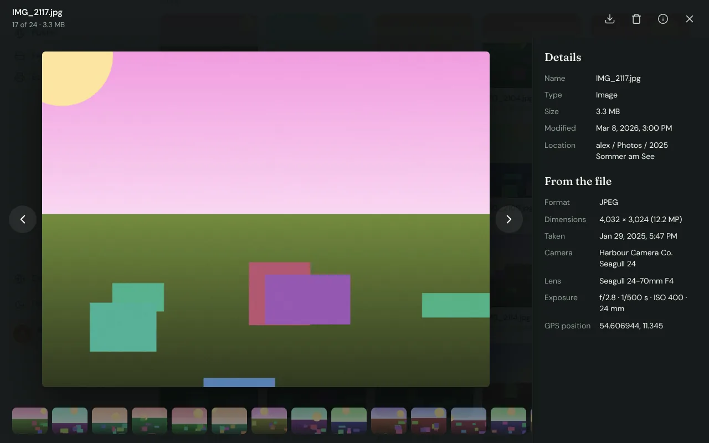

# The interface

ferry's interface is its own layout, "Hafen" — ported from the approved
mockup in [mockup/](mockup/index.html) — built with Angular and compiled into
the binary. It speaks English and German, follows the browser's language and
colour scheme, and keeps the viewer's choices (language, theme, tiles or
list) in the browser only.

## Signing in

The login page names the server (`FERRY_SERVER_NAME`) and the idle timeout.
The password goes to ferry once, in the login request, and on to the SMB
server; the form forgets it right after. When the server ends a session —
the idle timeout, the lifetime, a lost connection — the interface returns to
the login and says why.

Signing out clears what the browser cached for ferry (`Clear-Site-Data`),
thumbnails and details included, so that the next person at a shared
browser cannot page back to them. Two cases where it does not:

- **ferry served over plain HTTP.** Browsers honour `Clear-Site-Data` in a
  secure context only — HTTPS, or localhost. Without HTTPS, thumbnails and
  details stay in the browser's cache after signing out, for as long as the
  browser keeps them (up to a year), readable by whoever uses that browser
  profile next. A file's own content is asked for anew each time
  (`no-cache`): showing it again needs a session.
- **A session that times out.** No answer goes to the browser that could
  carry the header.

On a computer several people share, give each their own browser profile or
account, or clear the browsing data after use — or serve ferry over HTTPS
and sign out.

## Browsing

- **Shares** come as the server lists them. One the person may not open
  says so when opened; docs/samba.md has the setting that hides such shares.
- **Folders** show as tiles — folders first, then files with thumbnails for
  JPEG, PNG, GIF, WebP and BMP — or as a sortable list. The browser keeps a
  thumbnail, and a file's details, until the file changes: their URLs carry
  the version the listing gave (size and time of the last write), so coming
  back to a folder asks the server for its listing and nothing else.
- **Going back** to a folder seen a moment ago shows it at once, as it
  was, while ferry lists it anew; the new listing replaces it when
  complete. The interface keeps the last 20 folders (100000 entries in all,
  none above 20000) in the tab's memory only, never in the browser's
  storage, and forgets them when the session ends.
- **Search this folder** filters the names of the folder open; it searches
  nothing else.
- **Free space** shows under a folder's title and on each share's card —
  "3.2 TB free of 18 TB" with a thin bar — exactly as the SMB server reports
  it to the person (a quota included, when the server applies one). ferry
  works nothing out itself; when the server does not answer, the line is
  not there and the folder opens all the same.
- **Large folders** open at once: the entries arrive as the server lists
  them, and the first ones show while the rest come in. The page renders a
  few hundred tiles or rows and more as the end comes into view; sorting,
  the search and "select all" work on the whole folder. A folder with more
  entries than the deployment shows (`FERRY_MAX_LISTING`, 200000 by default)
  says how many that is.

## Selecting and acting

Click an entry to open it; with Shift, Ctrl or ⌘ — or once a selection is
running — a click selects. On touch, a long press starts a selection. The
dark bar above the folder acts on the selection: download, rename (one
entry), move, delete. A right click opens the same as a menu.

| key | does |
|---|---|
| ← → ↑ ↓, `j` `k` | move the selection |
| Enter | open the selected entry |
| Backspace, Alt+↑ | up one folder |
| Ctrl+A, ⌘A | select all |
| Delete | delete the selection, after asking |
| F2 | rename the selected entry |
| `/` | search this folder |
| Esc | clear the selection or the search, close the preview or a dialog |

In the preview: ← → for the previous and next file, `i` for the details,
Esc to close.

## Details

`i` or the ⓘ button in the preview shows a file's details: its name, type,
size, modification time and folder, and below them what the file says
about itself, read by ferry from its own bytes:

- **photos** — dimensions, when they were taken (by the camera's clock),
  camera and lens, aperture, exposure time, ISO and focal length, an
  orientation other than upright, and a GPS position as coordinates only —
  no map, nothing sent anywhere. JPEG, PNG, WebP, TIFF and HEIC (its EXIF
  read from the container, without decoding the picture);
- **PDFs** — pages, title, author and the program that made them;
- **recordings** — duration, codec, resolution, bitrate, sample rate,
  channels, title, artist and album, from MP4, MOV, M4A, MP3, FLAC and WAV,
  without ffmpeg;
- **texts** — encoding, lines and line endings.

Only a bounded part of a file is read (4 MiB at most), and nothing is
stored or written to a log. What the file says is shown as text: a camera
name or a title is never markup.

## Uploading

**Upload**, or drop files anywhere on the folder. Uploads run two at a time
with their progress in the panel at the bottom right. A file of the same name
is replaced only after asking. An upload that fails or is cancelled leaves
nothing on the share: ferry writes to a temporary name and renames it only
once the file is complete.

## Previews

Images, video, audio and PDF are shown by the browser itself, straight from
the server, sandboxed: nothing in a file runs in ferry's page. Text files —
HTML and SVG among them — are shown as text, the first 512 KB. Anything else
offers a download. HEIC photos and videos get an icon rather than a
thumbnail.

While an image is shown, the next and the previous one load ahead, so that
stepping to them shows them at once; videos and PDFs do not, and nothing
loads ahead when the browser is set to save data.

## Downloading

A file downloads through the browser's own download, with Range, so a large
download can resume. Several entries, or a folder, download as one ZIP,
named after the folder they are in (or the one entry): ferry lists what goes
in first — so that what the server refuses, or a selection beyond the
deployment's bound (`FERRY_MAX_ARCHIVE`, 10000 entries by default, folders'
contents counted), is said before anything downloads — and then writes the
archive as it reads the files, without a file of its own in between. The
files are stored, not compressed: photos and videos would not shrink, and
the download starts at once. Names keep their accents and emoji, files their
times, and archives beyond 4 GB are ZIP64, which every current unpacker
reads. Should a file fail once the archive has begun — deleted in the
meantime, or the connection gone — the download is broken off and the
browser reports it failed: never an archive that looks complete with a file
missing. A ZIP download cannot resume, and its size is not known before
it ends — each file's checksum is written after the file — so the browser
shows how much has come, not how much is left.

Deleting asks first and names how many. A selection larger than the
deployment's delete bound (`FERRY_MAX_DELETE`) is refused before anything is
deleted, as a folder with more in it is.

## Development

    make dev-nas run-nas   # the mock NAS, and ferry against it on :8095
    make ui-start          # the interface with live reload on :4200, against it
    make ui-lint ui-i18n ui-test ui-build

Every text is marked for translation (`i18n`, `` $localize ``) with an id;
`make ui-i18n` extracts them to `ui/src/locale/messages.json`, and their
German — in the du-form — goes into `messages.de.json`. A text without its
German fails the build. File names and share comments come from the server
and are never translated.
